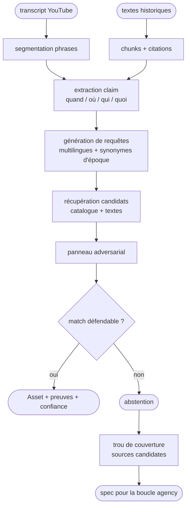

# Résolveur adversarial phrase → image d'archive

## Vision

La recherche répond à « trouve-moi des images sur X ». Le résolveur répond à
« **cette phrase historique précise** est-elle illustrable par une image
d'archive, et laquelle ? ».

Il prend en entrée :

- des **transcripts de vidéos d'histoire** (YouTube), découpés en phrases ;
- un **corpus de textes historiques** (livres, presse, archives) destiné à
  fournir le vocabulaire, les entités et les preuves.

Il produit :

1. pour chaque phrase, un **validé** (`match` : image + preuves + confiance) ou une
   **abstention** ;
2. pour chaque abstention, un **trou de couverture** : pays, période, type
   d'image, sources candidates à intégrer.

Le résolveur ne remplace pas les connecteurs d'images : il les utilise et les
met à l'épreuve.

## Deux boucles permanentes

```text
job:agency    → missions de source (codeur + navigateur)
job:resolver  → résolutions (une session par phrase)
```

Les deux jobs tournent en parallèle avec des leases séparés :

- `agency` ne sélectionne que les tâches `start_agent ∈ {coder, browser}` ;
- `resolver` ne sélectionne que les tâches `start_agent = resolver`.

`Database.next_task(agents=...)` filtre la famille ; le reste du cycle
(mailbox, cache de session, activation, events) est partagé. Le heartbeat a
`max_workers > 1`, donc les deux boucles avancent en même temps.

Une résolution est créée **par phrase** (ou par petit lot) à partir du
corpus / golden dataset. Elle porte `sentence_id`, la phrase, le claim et
les critères. Elle peut :

1. interroger la **meta API de Mnemosyne** (`Engine.search`, le registre des sources) ;
2. demander une revue humaine ;
3. demander l'ajout d'une ou plusieurs sources à l'Atelier ;
4. se parquer en attendant ces sources, puis être réveillée.

### La boucle s'alimente elle-même

`resolver.auto_feed: true` : quand une activation ne trouve aucune tâche
resolver à faire, le job enfile la **phrase suivante du corpus** (première
`resolver_corpus` qui n'a jamais eu de tâche). Aucun humain n'est nécessaire
pour maintenir le flux ; l'opérateur n'intervient que sur les verdicts.

### Deux garde-fous de validation

- **Pas d'auto-validation** : `record_result(match|partial)` est refusé tant
  qu'une question `ask_operator` de la tâche est `pending`. L'abstention
  (`no_match`/`ambiguous`) reste possible sans personne.
- **Titre ≠ sujet** : les grands fonds titrent une *série* (« The German
  Invasion of Belgium ») dont l'image montre parfois autre chose (des troupes
  belges à Ostend). La description tranche ; un titre trompeur est un négatif
  dur dans le golden dataset.

### Réveil par une source

Quand une mission de source liée à une `resolver_requests` se ferme, le
superviseur marque la demande `done`/`failed` et poste `[SOURCES READY]` au
résolveur dès qu'il n'attend plus aucune source. Le résolveur reprend alors la
phrase avec la meta API à jour.

## Agent resolver

Comme le coder/browser, c'est un agent Stirrup avec un runner et des outils
propres :

| Outil | Rôle |
|---|---|
| `catalog_inventory()` | liste toutes les sources avec état global, présence dans le périmètre et contexte (institution, pays, licence, tags, notes) |
| `catalog_toggle(source_ids)` | bascule l'état des sources **pour cette session** (active ↔ inactive), plusieurs d'un coup ; une source désactivée globalement ne peut pas être activée |
| `source_search(query, limit)` | cherche sur le web une **source** (archive, musée, API/IIIF) qui couvre un trou de couverture ; **jamais une image**, **4 recherches max**, des pistes à vérifier avant `request_source` |
| `catalog_search(query, limit)` | interroge la meta API **dans le périmètre courant** uniquement ; **6 recherches max par session**, ensuite le tool refuse |
| `video_context(before, after)` | résumé global, plan et fenêtre plus large autour de la phrase |
| `search_transcript(query)` | retrouve un terme, un lieu ou une personne dans la transcription |
| `read_transcript(start_s, end_s)` | lit la transcription entre deux timecodes |
| `record_illustration(image_url, sentence, context, image_context)` | vérifie le lien, la qualité et l'unicité, enregistre l'image exacte et renvoie un aperçu visuel |
| `request_source(source, reason)` | enqueue **une tâche agent par source** + dépendance |
| `wait_for_sources()` | parke la session resolver jusqu'à complétion |
| `record_result(status, asset_id, evidence)` | enregistre un `no_match`/`ambiguous` (le `match`/`partial` passe par `record_illustration`) |
| `ask_operator` | demande la validation humaine (Telegram/CLI) |

Le résolveur n'écrit pas dans le registre des sources : il lit la meta API et produit des
candidats, des verdicts et des demandes de sources.

### Une image par phrase, une phrase par image

`record_illustration` est le **tool de réussite** (inspection + enregistrement
en un appel). Il exige :

- l'URL exacte de l'image (pas la fiche) ;
- la phrase et le contexte source qu'elle illustre ;
- le contexte de l'image (ce qu'elle montre et pourquoi elle convient) ;
- un statut `match` ou `partial`.

Il vérifie que le lien renvoie une image réelle, que ses dimensions et son
poids passent le minimum (`resolver.min_image_side`, `resolver.min_image_bytes`),
et que l'image **n'est pas déjà utilisée par une autre résolution** — toutes
sources confondues. La contrainte est aussi en base (`image_url UNIQUE`,
`asset_id UNIQUE`, `resolver_task_id UNIQUE`) : impossible de réutiliser la
même photo pour toutes les phrases d'une vidéo. En cas de succès, le tool
renvoie l'aperçu de l'image dans le résultat : le modèle peut vérifier qu'elle
correspond ; sinon il rappelle le tool avec une autre image (la dernière
remplace la précédente) ou enregistre `no_match`.

Un **403 transitoire** est réessayé **une fois** (429/5xx : jusqu'à 3, backoff) et un échec n'est
**jamais mis en cache** : le modèle peut réessayer. Si l'URL native est refusée,
le fetcher tente une variante **officielle** de la même image (Gallica
`full/1024,`, Wikimedia `Special:FilePath`) avec un `Referer` de la fiche. Aucun
contournement de blocage, aucun miroir, aucun réhébergement : si l'institution
refuse durablement, on choisit une autre image ou on s'abstient.

### Contexte vidéo

Chaque tâche reçoit une **fiche de contexte** : titre, durée, résumé global,
période, lieux, entités, plan et ~15 segments avant/après la phrase. Le résumé
est généré **une fois par vidéo** et stocké dans `video_contexts` :

```bash
mnemosyne resolve context --video <video_id>   # ou sans --video : toutes
mnemosyne resolve context --force              # régénère
```

Si la fiche ne suffit pas, les trois outils `video_context`,
`search_transcript` et `read_transcript` permettent d'élargir ou de chercher
dans la transcription. La transcription est un **contexte**, jamais une preuve
de provenance pour l'image.

Comme les autres agents, il peut poser une question à l'opérateur (`ask_operator`) :
questionnaire à boutons + réponse libre, attaché à sa session resolver. La
réponse le réveille au tick suivant. Il n'a **pas** `wait_for_email` : l'email
est le domaine du navigateur.


## Demandes de sources et réveil

```text
resolver task (sentence)
  └─ request_source("kbr.be")
       └─ agent task (coder/browser) : ajouter la source
            └─ à la fermeture : resolver_requests.status = done
                 └─ si toutes les demandes sont terminales :
                      mailbox system → resolver
                      next_task() réveille la session resolver
```

Table `resolver_requests` :

```sql
resolver_requests (
  id INTEGER PRIMARY KEY,
  resolver_task_id INTEGER NOT NULL,
  sentence_id TEXT,
  source_id TEXT,
  source_name TEXT,
  agent_task_id INTEGER,
  status TEXT,              -- pending|running|done|failed
  created_at TEXT,
  completed_at TEXT,
  note TEXT
)
```

- `request_source` crée la mission de source et la ligne `resolver_requests`.
- Le supervisor, à la fermeture d'une tâche agent, marque la demande
  `done`/`failed`.
- Quand toutes les demandes d'une session resolver sont terminales, il poste
  un message `system → resolver` et la session reprend.
- Pendant l'attente, `next_task()` parke la session resolver (zéro token,
  file non bloquée). Contrairement à `ask_operator`, qui attend la réponse
  dans le même tour, une demande de source parque la session.

## Vérification humaine / anti-triche

Le resolver ne peut pas se contenter d'un score. Pour chaque résultat validé :

1. il présente le résultat, la source, la licence, la date, le lieu, la caption et
   les preuves ;
2. il demande une revue via `ask_operator` :
   - `Valide`
   - `Refuse`
   - `Ambigu`
3. la réponse est stockée dans `resolver_reviews` et, si `Valide`, devient une
   ligne `resolver_golden` (label humain) ;
4. un `Refuse` devient un **hard negative** rejoué plus tard.

Contrôles anti-triche automatiques avant la revue :

- l'URL image doit venir de la source/notice (pas d'image générée ou stock) ;
- licence et provenance présentes ;
- date de l'image compatible avec le claim (pas d'anachronisme) ;
- l'agent ne peut pas réutiliser une image d'une autre phrase sans preuve ;
- toute image non issue du registre des sources / meta API est refusée.

## Méta API

Le resolver consomme la même API que le reste de mnemosyne :

- `Engine.search(query, source_ids, limit)` pour les candidats ;
- `/api/search?q=...` si l'API HTTP est utilisée ;
- les résultats normalisés (`Asset`) avec `source_id`, `page_url`, `image_url`,
  `license`, `rights`, `extra`.

Il ne scrape pas les sites des institutions : il utilise les connecteurs et
les URLs canoniques.


## Non-objectifs

- Ce n'est pas un générateur d'images.
- Ce n'est pas un « common crawl » : on interroge les APIs/passages nécessaires.
- Ce n'est pas un juge automatique sans humain : le golden dataset et la revue
  opérateur restent la référence.

## Pipeline



## Modèle de données (SQLite, même DB que le registre des sources)

```sql
texts (
  id TEXT PRIMARY KEY,
  source TEXT, title TEXT, author TEXT, date TEXT, language TEXT,
  license TEXT, url TEXT, content TEXT, retrieved_at TEXT
)

text_chunks (
  id INTEGER PRIMARY KEY,
  text_id TEXT, ordinal INTEGER, content TEXT,
  start_char INTEGER, end_char INTEGER
)

segments (
  id TEXT PRIMARY KEY,             -- yt_<video>_<index>
  video_id TEXT, video_title TEXT, channel TEXT, video_url TEXT,
  start_s REAL, end_s REAL, text TEXT
)

video_contexts (
  video_id TEXT PRIMARY KEY,
  title TEXT, duration_s REAL,
  summary TEXT, outline_json TEXT, meta_json TEXT,
  model TEXT, created_at TEXT, updated_at TEXT
)

claims (
  segment_id TEXT PRIMARY KEY,
  when_text TEXT, where_text TEXT, who_json TEXT,
  what_text TEXT, event_type TEXT, visual_intent TEXT,
  must_include_json TEXT, must_exclude_json TEXT,
  queries_json TEXT, model TEXT, created_at TEXT
)

candidates (
  id INTEGER PRIMARY KEY,
  segment_id TEXT, asset_id TEXT, query TEXT,
  rank INTEGER, score REAL, evidence_json TEXT, created_at TEXT
)

verdicts (
  id INTEGER PRIMARY KEY,
  candidate_id INTEGER, lens TEXT,          -- support|refute|anachronism|provenance|visual
  verdict TEXT,                             -- support|reject|neutral
  confidence REAL, reasons_json TEXT, model TEXT, created_at TEXT
)

matches (
  segment_id TEXT PRIMARY KEY,
  asset_id TEXT, status TEXT,               -- match|partial|no_match|ambiguous
  confidence REAL, chosen_by TEXT, reasons_json TEXT, created_at TEXT
)

golden_labels (
  segment_id TEXT PRIMARY KEY,
  status TEXT, images_json TEXT, hard_negatives_json TEXT,
  notes TEXT, annotator TEXT, updated_at TEXT
)

resolver_requests (
  id INTEGER PRIMARY KEY,
  resolver_task_id INTEGER NOT NULL,
  sentence_id TEXT, source_id TEXT, source_name TEXT,
  agent_task_id INTEGER, status TEXT, created_at TEXT,
  completed_at TEXT, note TEXT
)

resolver_reviews (
  id INTEGER PRIMARY KEY,
  resolver_task_id INTEGER, asset_id TEXT,
  verdict TEXT,             -- valide|refuse|ambigu
  reviewer TEXT, notes TEXT, reviewed_at TEXT
)
```

Les `candidates` pointent vers `assets` ; aucune image n'est dupliquée.

## Golden dataset

Un JSONL, une ligne par phrase. Schéma JSON :
[`schemas/golden_sentence.schema.json`](../schemas/golden_sentence.schema.json).

```json
{
  "id": "yt_<video_id>_<sentence_index>",
  "video": {
    "id": "<youtube id>",
    "title": "...",
    "channel": "...",
    "url": "https://www.youtube.com/watch?v=...",
    "published_at": "2026-01-01"
  },
  "segment": {
    "start_s": 123.4,
    "end_s": 130.2,
    "text": "In 1914, the German army crossed into neutral Belgium."
  },
  "claim": {
    "when": "1914",
    "where": "Belgium",
    "who": ["German army"],
    "event": "invasion of Belgium"
  },
  "gold": {
    "status": "match",
    "images": [
      {
        "url": "https://...",
        "source_id": "gallica",
        "source_asset_id": "...",
        "why": "photo de l'entrée des troupes à Bruxelles, 1914"
      }
    ],
    "hard_negatives": [
      {
        "url": "https://...",
        "why_wrong": "même guerre, mais 1918 / autre ville"
      }
    ]
  },
  "notes": "Une photo de réfugiés belges est aussi acceptable.",
  "annotator": "operator"
}
```

Règles d'annotation :

- `match` (validé) : au moins une image défendable pour la phrase ;
- `partial` : l'image illustre une partie seulement (ex. le bon pays, la
  mauvaise année) ;
- `no_match` (abstention) : aucune image du registre des sources ne convient — **très important** ;
- `ambiguous` : désaccord ou image discutable ;
- toujours fournir des **hard negatives** quand ils existent ;
- plusieurs images acceptables sont autorisées ;
- conserver `video_id` + timestamps pour la traçabilité.

### Import / validation

```bash
# valider sans écrire
mnemosyne resolve import-golden data/golden.jsonl --dry-run

# importer (upsert idempotent par segment_id)
mnemosyne resolve import-golden data/golden.jsonl

# état du dataset importé
mnemosyne resolve stats

# générer la fiche de contexte globale (résumé + plan) — une fois par vidéo
mnemosyne resolve context
mnemosyne resolve context --video <video_id> --force

# mettre une phrase dans la boucle resolver (une session par segment)
mnemosyne resolve enqueue yt_<video_id>_<sentence_index>
```

### Corpus vs golden

Deux jeux distincts, deux usages :

| Table | Contenu | Usage |
|---|---|---|
| `resolver_corpus` | phrases **à traiter** (transcript, JSONL, claim) — aucun label requis | flux de travail du resolver |
| `resolver_golden` | paires **évaluées** `match/partial/no_match/ambiguous` + images acceptables + négatifs durs | benchmark (précision, abstention) |

```bash
# importer un transcript (un segment = une phrase, ids yt_<video_id>_<index>)
mnemosyne resolve ingest data/transcript.json --dry-run
mnemosyne resolve ingest data/transcript.json --prefix nb_

# JSONL minimal ou tableau JSON
mnemosyne resolve ingest data/sentences.jsonl --min-words 5

# enfiler une phrase du corpus (le golden est prioritaire si l'id existe des deux côtés)
mnemosyne resolve enqueue yt_<video_id>_<index>
```

`resolve enqueue` refuse d'ouvrir une deuxième session pour une phrase déjà
`pending`/`running`, et rappelle la vidéo + le claim quand ils sont connus.


## Panneau adversarial

Chaque candidat passe des lentilles indépendantes :

| Lentille | Question | Veto |
|---|---|---|
| `support` | Quelles preuves relient l'image au claim ? | non |
| `refute` | Existe-t-il une contradiction fatale ? | oui |
| `anachronism` | L'image est-elle postérieure à l'événement ? | oui |
| `provenance` | Source, caption, licence, crédibilité | oui si licence/notice incompatible |
| `visual` | Que montre réellement l'image ? | oui si sujet incompatible |

Le `judge` agrège :

```text
score = support - (2 × refute) - penalités
```

- `match` si score ≥ seuil haut et aucun veto ;
- `partial` si score moyen ;
- `no_match` si score < seuil bas ou deux candidats trop proches ;
- sinon `ambiguous` (revue humaine).

Le système doit **préférer l'abstention** à un faux match.

## Boucle adversariale

- Les faux positifs et les near-miss deviennent des **hard negatives** rejoués à
  chaque nouveau modèle/source.
- Les phrases `no_match` sont agrégées par `(pays, période, type)` pour produire
  des **specs de sources** :
  ```json
  {
    "claim": "...",
    "missing": {"country": "BE", "period": "1914", "type": "photo de rue"},
    "candidate_sources": ["Amsab", "KBR", "Bundesarchiv"]
  }
  ```
- Ces specs alimentent la boucle `agency` (browser/coder) qui ajoute les sources.

## Textes historiques

Ils servent à :

- enrichir le vocabulaire et les entités (noms, lieux, unités d'époque) ;
- fournir des **citations** qui soutiennent ou réfutent un candidat ;
- générer des requêtes plus précises que la phrase YouTube.

Sources de départ : Gutenberg/Gutendex, Wikisource, Internet Archive, Gallica,
Europeana, ANNO, NDL, Delpher, Perseus/Fordham. On stocke des **passages** avec
source, date, langue et citation — pas des livres entiers.

## Évaluation

Sur le golden dataset :

- `precision@1`, `recall@k`, taux de faux matchs, taux d'abstention ;
- calibration de la confiance (Brier) ;
- slices par période, pays, type de claim, source ;
- rejeu des hard negatives.

Objectif : **maximiser les phrases correctement illustrées sans inventer**.

## Étapes d'implémentation

1. Agent `resolver` + job `resolver` séparé (lease dédié) et `next_task(agents=...)`.
2. Outils meta API (`catalog_search`, `asset_details`) + création d'une session
   resolver par phrase.
3. `request_source` + `resolver_requests` + réveil à la fermeture des tâches
   agents (dépendances).
4. Revue humaine via `ask_operator` + `resolver_reviews` (et hard negatives).
5. Panneau adversarial + juge + abstention.
6. Ingestion des textes historiques + chunks/BM25.
7. CLI `mnemosyne resolve ...` + rapport d'évaluation.
8. Vue observatory : deux boucles, session resolver, demandes de sources.

## Questions ouvertes

- Format exact des transcripts du golden dataset (VTT/SRT/JSONL ?).
- Un label `partial` doit-il compter comme succès dans la métrique principale ?
- Seuils de confiance et politique d'abstention.
- Modèle vision : API (Zen) vs modèle local.
- Périmètre initial : une chaîne YouTube + une période + 50–100 phrases.
