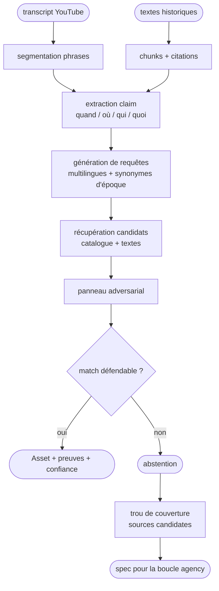

# Résolveur adversarial phrase → image d'archive

## Vision

Le catalogue répond à « trouve-moi des images sur X ». Le résolveur répond à
« **cette phrase historique précise** est-elle illustrable par une image
d'archive, et laquelle ? ».

Il prend en entrée :

- des **transcripts de vidéos d'histoire** (YouTube), découpés en phrases ;
- un **corpus de textes historiques** (livres, presse, archives) destiné à
  fournir le vocabulaire, les entités et les preuves.

Il produit :

1. pour chaque phrase, un **match** (image + preuves + confiance) ou une
   **abstention** ;
2. pour chaque abstention, un **trou de couverture** : pays, période, type
   d'image, sources candidates à onboarder.

Le résolveur ne remplace pas les connecteurs d'images : il les utilise et les
met à l'épreuve.

## Deux boucles permanentes

```text
job:agency    → tâches coder/browser (sources, code, navigateur)
job:resolver  → tâches resolver (une session par phrase)
```

Les deux jobs tournent en parallèle avec des leases séparés :

- `agency` ne sélectionne que les tâches `start_agent ∈ {coder, browser}` ;
- `resolver` ne sélectionne que les tâches `start_agent = resolver`.

`Database.next_task(agents=...)` filtre la famille ; le reste du cycle
(mailbox, cache de session, activation, events) est partagé. Le heartbeat a
`max_workers > 1`, donc les deux boucles avancent en même temps.

Une tâche resolver est créée **par phrase** (ou par petit lot) à partir du
golden dataset / transcript. Elle porte `sentence_id`, la phrase, le claim et
les critères. Elle peut :

1. interroger la **meta API du biagent** (`Engine.search`, le catalogue) ;
2. demander une revue humaine ;
3. demander l'ajout d'une ou plusieurs sources au biagent ;
4. se parquer en attendant ces sources, puis être réveillée.

## Agent resolver

Comme le coder/browser, c'est un agent Stirrup avec un runner et des outils
propres :

| Outil | Rôle |
|---|---|
| `catalog_search(query, limit)` | interroge la meta API (catalogue, connecteurs) |
| `asset_details(asset_id)` | vérifie provenance, date, lieu, licence, image |
| `propose_sources(claim)` | cherche des APIs/sources candidates (LLM/recherche) |
| `request_source(source, reason)` | enqueue **une tâche biagent par source** + dépendance |
| `wait_for_sources()` | parke la session resolver jusqu'à complétion |
| `submit_for_review(asset_id, evidence)` | demande la validation humaine (Telegram/CLI) |
| `abstain(reason, missing)` | enregistre `no_match` + gap de couverture |
| `ask_operator` / `wait_for_email` | réutilisés tels quels |

Le resolver n'écrit pas dans le catalogue : il lit la meta API et produit des
candidats, des verdicts et des demandes de sources.

Comme le biagent, il peut poser une question à l'opérateur (`ask_operator`) :
questionnaire à boutons + réponse libre, attaché à sa session resolver. La
réponse le réveille au tick suivant. Il peut aussi utiliser `wait_for_email`
pour une réponse externe.


## Demandes de sources et réveil

```text
resolver task (sentence)
  └─ request_source("kbr.be")
       └─ biagent task (coder/browser) : ajouter la source
            └─ à la fermeture : resolver_requests.status = done
                 └─ si toutes les demandes sont terminales :
                      mailbox system → resolver
                      next_task() réveille la session resolver
```

Table `resolver_requests` :

```sql
resolver_requests (
  id INTEGER PRIMARY KEY,
  resolver_task_id INTEGER NOT NULL,
  sentence_id TEXT,
  source_id TEXT,
  source_name TEXT,
  biagent_task_id INTEGER,
  status TEXT,              -- pending|running|done|failed
  created_at TEXT,
  completed_at TEXT,
  note TEXT
)
```

- `request_source` crée la tâche biagent et la ligne `resolver_requests`.
- Le supervisor, à la fermeture d'une tâche biagent, marque la demande
  `done`/`failed`.
- Quand toutes les demandes d'une session resolver sont terminales, il poste
  un message `system → resolver` et la session reprend.
- Pendant l'attente, `next_task()` parke la session resolver (zéro token,
  file non bloquée), exactement comme un `ask_operator` ou un `wait_for_email`.

## Vérification humaine / anti-triche

Le resolver ne peut pas se contenter d'un score. Pour chaque match :

1. il présente l'asset, la source, la licence, la date, le lieu, la caption et
   les preuves ;
2. il demande une revue via `ask_operator` :
   - `Valide`
   - `Refuse`
   - `Ambigu`
3. la réponse est stockée dans `resolver_reviews` et, si `Valide`, devient une
   ligne `resolver_golden` (label humain) ;
4. un `Refuse` devient un **hard negative** rejoué plus tard.

Contrôles anti-triche automatiques avant la revue :

- l'URL image doit venir de la source/notice (pas d'image générée ou stock) ;
- licence et provenance présentes ;
- date de l'image compatible avec le claim (pas d'anachronisme) ;
- l'agent ne peut pas réutiliser une image d'une autre phrase sans preuve ;
- toute image non issue du catalogue/meta API est refusée.

## Méta API

Le resolver consomme la même API que le reste de mnemosyne :

- `Engine.search(query, source_ids, limit)` pour les candidats ;
- `/api/assets/...` si l'API HTTP est utilisée ;
- les assets normalisés (`Asset`) avec `source_id`, `page_url`, `image_url`,
  `license`, `rights`, `extra`.

Il ne scrape pas les sites des fournisseurs : il utilise les connecteurs et
les URLs canoniques.


## Non-objectifs

- Ce n'est pas un générateur d'images.
- Ce n'est pas un « common crawl » : on interroge les APIs/passages nécessaires.
- Ce n'est pas un juge automatique sans humain : le golden dataset et la revue
  opérateur restent la référence.

## Pipeline



## Modèle de données (SQLite, même DB que le catalogue)

```sql
texts (
  id TEXT PRIMARY KEY,
  source TEXT, title TEXT, author TEXT, date TEXT, language TEXT,
  license TEXT, url TEXT, content TEXT, retrieved_at TEXT
)

text_chunks (
  id INTEGER PRIMARY KEY,
  text_id TEXT, ordinal INTEGER, content TEXT,
  start_char INTEGER, end_char INTEGER
)

segments (
  id TEXT PRIMARY KEY,             -- yt_<video>_<index>
  video_id TEXT, video_title TEXT, channel TEXT, video_url TEXT,
  start_s REAL, end_s REAL, text TEXT
)

claims (
  segment_id TEXT PRIMARY KEY,
  when_text TEXT, where_text TEXT, who_json TEXT,
  what_text TEXT, event_type TEXT, visual_intent TEXT,
  must_include_json TEXT, must_exclude_json TEXT,
  queries_json TEXT, model TEXT, created_at TEXT
)

candidates (
  id INTEGER PRIMARY KEY,
  segment_id TEXT, asset_id TEXT, query TEXT,
  rank INTEGER, score REAL, evidence_json TEXT, created_at TEXT
)

verdicts (
  id INTEGER PRIMARY KEY,
  candidate_id INTEGER, lens TEXT,          -- support|refute|anachronism|provenance|visual
  verdict TEXT,                             -- support|reject|neutral
  confidence REAL, reasons_json TEXT, model TEXT, created_at TEXT
)

matches (
  segment_id TEXT PRIMARY KEY,
  asset_id TEXT, status TEXT,               -- match|partial|no_match|ambiguous
  confidence REAL, chosen_by TEXT, reasons_json TEXT, created_at TEXT
)

golden_labels (
  segment_id TEXT PRIMARY KEY,
  status TEXT, images_json TEXT, hard_negatives_json TEXT,
  notes TEXT, annotator TEXT, updated_at TEXT
)

resolver_requests (
  id INTEGER PRIMARY KEY,
  resolver_task_id INTEGER NOT NULL,
  sentence_id TEXT, source_id TEXT, source_name TEXT,
  biagent_task_id INTEGER, status TEXT, created_at TEXT,
  completed_at TEXT, note TEXT
)

resolver_reviews (
  id INTEGER PRIMARY KEY,
  resolver_task_id INTEGER, asset_id TEXT,
  verdict TEXT,             -- valide|refuse|ambigu
  reviewer TEXT, notes TEXT, reviewed_at TEXT
)
```

Les `candidates` pointent vers `assets` ; aucune image n'est dupliquée.

## Golden dataset

Un JSONL, une ligne par phrase. Schéma JSON :
[`schemas/golden_sentence.schema.json`](../schemas/golden_sentence.schema.json).

```json
{
  "id": "yt_<video_id>_<sentence_index>",
  "video": {
    "id": "<youtube id>",
    "title": "...",
    "channel": "...",
    "url": "https://www.youtube.com/watch?v=...",
    "published_at": "2026-01-01"
  },
  "segment": {
    "start_s": 123.4,
    "end_s": 130.2,
    "text": "In 1914, the German army crossed into neutral Belgium."
  },
  "claim": {
    "when": "1914",
    "where": "Belgium",
    "who": ["German army"],
    "event": "invasion of Belgium"
  },
  "gold": {
    "status": "match",
    "images": [
      {
        "url": "https://...",
        "source_id": "gallica",
        "source_asset_id": "...",
        "why": "photo de l'entrée des troupes à Bruxelles, 1914"
      }
    ],
    "hard_negatives": [
      {
        "url": "https://...",
        "why_wrong": "même guerre, mais 1918 / autre ville"
      }
    ]
  },
  "notes": "Une photo de réfugiés belges est aussi acceptable.",
  "annotator": "operator"
}
```

Règles d'annotation :

- `match` : au moins une image défendable pour la phrase ;
- `partial` : l'image illustre une partie seulement (ex. le bon pays, la
  mauvaise année) ;
- `no_match` : aucune image du catalogue ne convient — **très important** ;
- `ambiguous` : désaccord ou image discutable ;
- toujours fournir des **hard negatives** quand ils existent ;
- plusieurs images acceptables sont autorisées ;
- conserver `video_id` + timestamps pour la traçabilité.

### Import / validation

```bash
# valider sans écrire
mnemosyne resolve import-golden data/golden.jsonl --dry-run

# importer (upsert idempotent par segment_id)
mnemosyne resolve import-golden data/golden.jsonl

# état du dataset importé
mnemosyne resolve stats

# mettre une phrase dans la boucle resolver (une session par segment)
mnemosyne resolve enqueue yt_<video_id>_<sentence_index>
```


## Panneau adversarial

Chaque candidat passe des lentilles indépendantes :

| Lentille | Question | Veto |
|---|---|---|
| `support` | Quelles preuves relient l'image au claim ? | non |
| `refute` | Existe-t-il une contradiction fatale ? | oui |
| `anachronism` | L'image est-elle postérieure à l'événement ? | oui |
| `provenance` | Source, caption, licence, crédibilité | oui si licence/notice incompatible |
| `visual` | Que montre réellement l'image ? | oui si sujet incompatible |

Le `judge` agrège :

```text
score = support - (2 × refute) - penalités
```

- `match` si score ≥ seuil haut et aucun veto ;
- `partial` si score moyen ;
- `no_match` si score < seuil bas ou deux candidats trop proches ;
- sinon `ambiguous` (revue humaine).

Le système doit **préférer l'abstention** à un faux match.

## Boucle adversariale

- Les faux positifs et les near-miss deviennent des **hard negatives** rejoués à
  chaque nouveau modèle/source.
- Les phrases `no_match` sont agrégées par `(pays, période, type)` pour produire
  des **specs de sources** :
  ```json
  {
    "claim": "...",
    "missing": {"country": "BE", "period": "1914", "type": "photo de rue"},
    "candidate_sources": ["Amsab", "KBR", "Bundesarchiv"]
  }
  ```
- Ces specs alimentent la boucle `agency` (browser/coder) qui ajoute les sources.

## Textes historiques

Ils servent à :

- enrichir le vocabulaire et les entités (noms, lieux, unités d'époque) ;
- fournir des **citations** qui soutiennent ou réfutent un candidat ;
- générer des requêtes plus précises que la phrase YouTube.

Sources de départ : Gutenberg/Gutendex, Wikisource, Internet Archive, Gallica,
Europeana, ANNO, NDL, Delpher, Perseus/Fordham. On stocke des **passages** avec
source, date, langue et citation — pas des livres entiers.

## Évaluation

Sur le golden dataset :

- `precision@1`, `recall@k`, taux de faux matchs, taux d'abstention ;
- calibration de la confiance (Brier) ;
- slices par période, pays, type de claim, source ;
- rejeu des hard negatives.

Objectif : **maximiser les phrases correctement illustrées sans inventer**.

## Étapes d'implémentation

1. Agent `resolver` + job `resolver` séparé (lease dédié) et `next_task(agents=...)`.
2. Outils meta API (`catalog_search`, `asset_details`) + création d'une session
   resolver par phrase.
3. `request_source` + `resolver_requests` + réveil à la fermeture des tâches
   biagent (dépendances).
4. Revue humaine via `ask_operator` + `resolver_reviews` (et hard negatives).
5. Panneau adversarial + juge + abstention.
6. Ingestion des textes historiques + chunks/BM25.
7. CLI `mnemosyne resolve ...` + rapport d'évaluation.
8. Vue observatory : deux boucles, session resolver, demandes de sources.

## Questions ouvertes

- Format exact des transcripts du golden dataset (VTT/SRT/JSONL ?).
- Un label `partial` doit-il compter comme succès dans la métrique principale ?
- Seuils de confiance et politique d'abstention.
- Modèle vision : API (Zen) vs modèle local.
- Périmètre initial : une chaîne YouTube + une période + 50–100 phrases.
